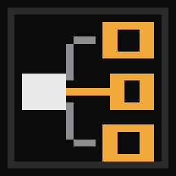
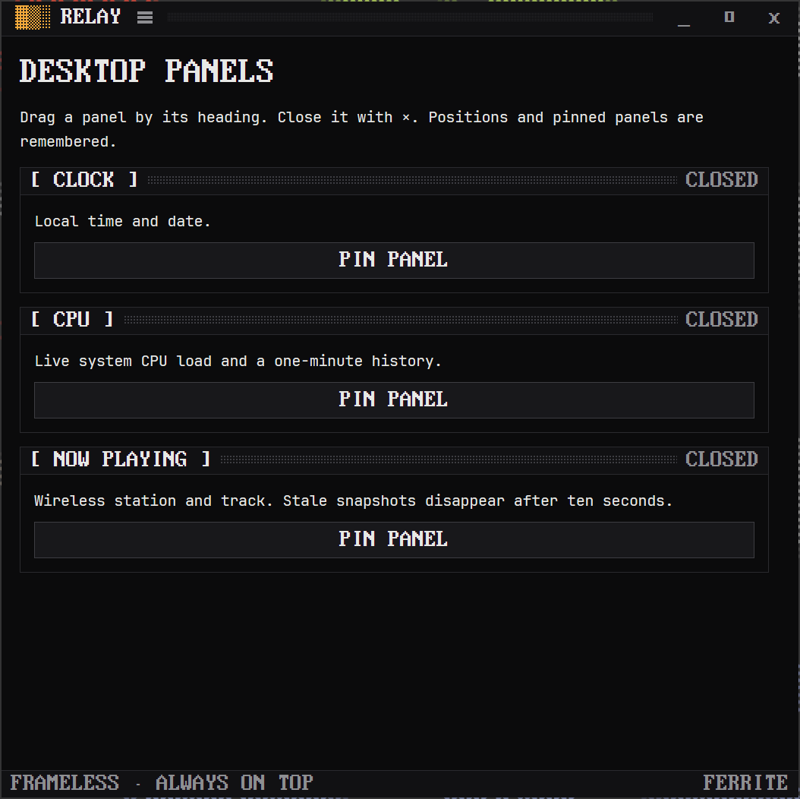

  

<h1 align="center">Relay</h1>

  Frameless, always-on-top Ferrite desktop panels: clock, CPU load and Wireless's now playing.

  
  
  

Pin or close panels from Relay, its Ctrl+Shift+P command palette, or each panel's close button. Drag headings to position panels. Pinned state and window positions are saved locally. All open panels follow Relay's selected scheme and appearance. Closing the manager leaves pinned panels running.

Now playing reads Wireless v0.3.3 or newer through %APPDATA%/ferrite/wireless-now-playing.json. A stopped player, unsupported snapshot version, or snapshot older than ten seconds shows inactive, never an old track as live. It integrates with Wireless only.

## Install

Download the Windows x64 zip from Releases, or install Relay through Lodestone. SHA256SUMS.txt accompanies each release. Main pushes automatically produce versioned releases. This initial release targets Windows; CPU sampling and native frameless pinning use Windows APIs.

## Develop

Rust 1.92 or newer: cargo run. Run cargo test and cargo clippy --all-targets. `--smoke` checks CPU sampling; `--widgets` opens all three panels for inspection; `--version` reports the version.

Panel state: %APPDATA%/ferrite/relay-widgets.json. Window positions use the Ferrite window store. Apache-2.0.

## Settings

Open the sliders button in the title bar, press Ctrl+, or choose Settings from the command palette. All ten schemes, Dark/Light/System appearance, motion refresh rate (12 to 240 FPS), and row density apply immediately and persist per app. Save failures appear in Settings. Start with `--settings` to open the drawer directly. Ferrite launcher environment overrides take precedence at startup.

## Keys

| Keys | |
|---|---|
| <kbd>Ctrl</kbd>+<kbd>Shift</kbd>+<kbd>P</kbd> | Command palette |
| <kbd>Ctrl</kbd>+<kbd>,</kbd> | Settings |

---

  <picture>
    <source media="(prefers-color-scheme: dark)" srcset="docs/brand/heptagram-white.svg">
    
  </picture>

